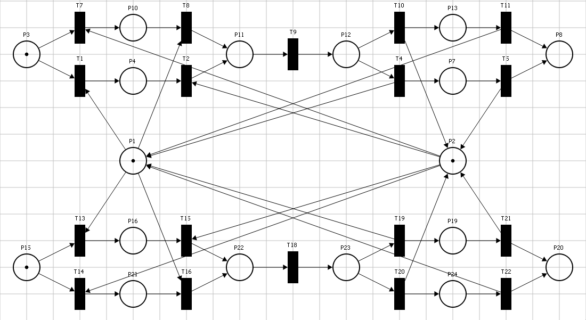
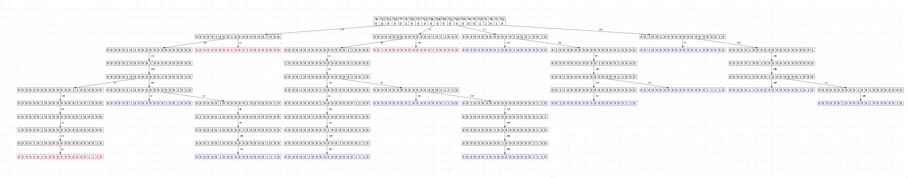
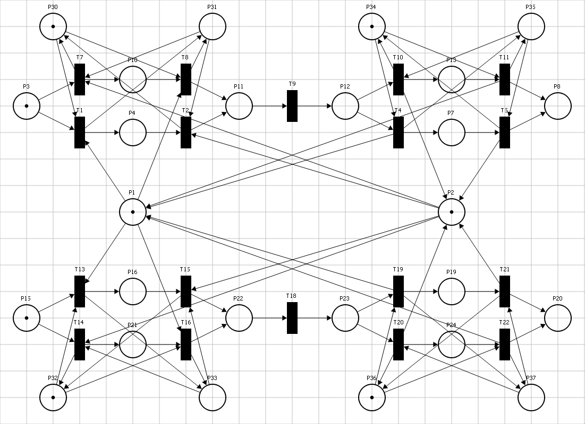
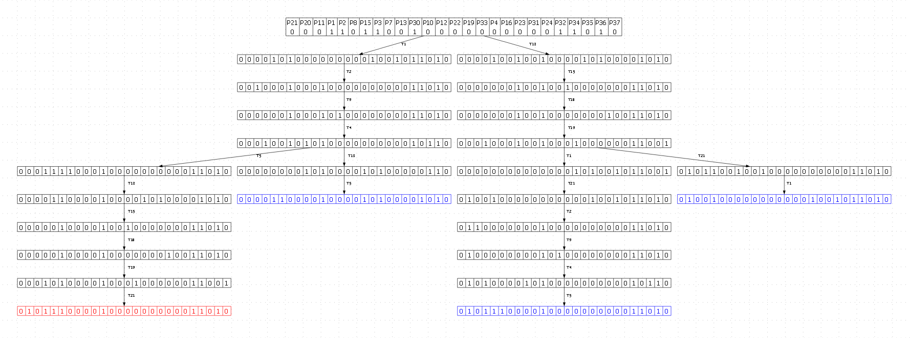
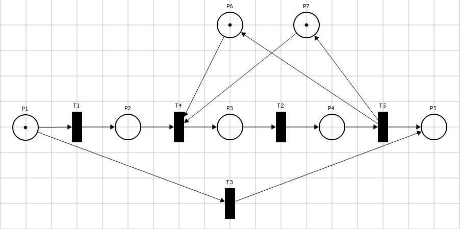
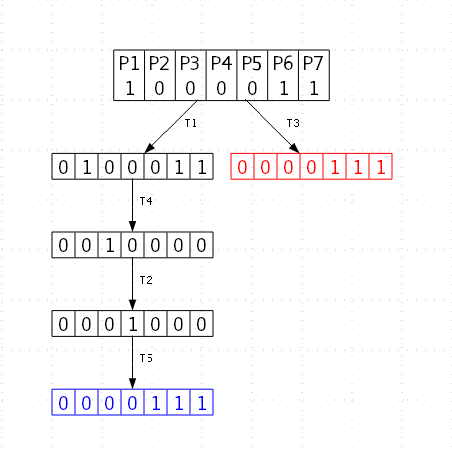

`Механизмы формирования контроля доступа к ресурсам в документно-реляционных базах данных`
========================

Фамилия Имя Отчество,
Организация, должность, ученая степень, город, страна
электронный адрес

## Аннотация
250-500 знаков.
Традиционные методы конкурентного доуступа к ресурсу в документных базах данных на уровне целого документа в распределенных средах создают существенные узкие места для производительности, тогда как предлагаемый в докладе механизма управления конкурентным доступом на основе автоматически выводимых иерархических схем позволяет минимизировать конфликты доступа и повысить общую пропускную способность.

## Ключевые слова
Распределённые СУБД, документно-реляционная модель, управление конкурентным доступом, иерархические блокировки, предотвращение тупиковых ситуаций, сети Петри, взаимодействующие последовательные процессы.

## Введение

Эволюция современных систем управления базами данных характеризуется постоянным поиском баланса между гибкостью модели данных и требованиями к транзакционной целостности. Рост популярности документоориентированных СУБД обусловлен их способностью эффективно работать с полуструктурированными данными. Однако отказ от жесткой схемы данных в таких системах часто приводит к компромиссам в области управления конкурентным доступом.  В статье провелена разработка методов реализации документно-реляционной базы данных, совмещающей гибкость хранения документов с механизмами контроля целостности. Предлагаемый подход позволяет хранить данные в виде иерархических структур, обеспечивая при этом выполнение требований ACID[12]. Ключевой проблемой при реализации такой системы в распределенной среде является управление блокировками. Будет проведена формализация и верификация алгоритмов контроля доступа при помощи средств моделирования взаимодействующи последовательных процессов и сетей Петри.

## Названия разделов или глав (13000 знаков.)


### Краткое описание системы
В данной работе предлагается архитектура документно-реляционной структуры базы данных. В системе предполагается хранить документы со внутренней иерархической структурой, например JSON. Основной метод представления данных базируется на декомпозиции исходного документа на отдельные атрибуты в виде пар «ключ — значение» для последующего размещения во внутреннем хранилище. В качестве ключа выступаетv путь от идентификатора коллекции и названия документа в этой коллекции, до конкретного атрибута. Такой подход позволяет системе работать с данными на уровне отдельных атрибутов, избегая избыточного чтения и перезаписи всего документа целиком. Название коллекции документов, название документов отделяются двоеточием части пути разделяются точкой. Например файл представленный на листинге 1, будет преобразован в записи представленные в таблице 1.
```JSON
{
    "scalar": "some value",
    "array": ["first", "another"],
    "object": {
        "internal key": 1
    }
}
```
| key | value |
| --- | --- |
| collection_1:document_1:scalar | "some value"|
| collection_1:document_1:array | [1, 2] |
| collection_1:document_1:array[1] | "first" |
| collection_1:document_1:array[2] | "another"|
| collection_1:document_1:object | ["internal key"] |
| collection_1:document_1:object.internal key | 1 |


С целью минимизации вычислительных затрат и исключения необходимости полного сканирования коллекции при выборе нужных атрибутов на этапе выполнения запросов, в системе применяется модуль управления метаданными. Данный компонент обеспечивает хранение и изменение глобальной схемы, которая отражает все атрибуты для документов в рамках конкретной коллекции.

Процесс управления доступом базируется на механизме динамического формирования дерева из атрибутов в документе, с выданными метками доступа к этим атрибутам. Метки бывают пяти видов:
- IS (Intention Shared): Намерение на чтение данных на более низких уровнях дерева.
- IX (Intention Exclusive): Намерение на модификацию данных на более низких уровнях.
- S (Shared): Разделяемый доступ к текущему узлу и всем его потомкам.
- SIX (Shared Intention Exclusive): Разделяемый доступ к текущему узлу с возможным повышением до эксклюзивного доступа.
- X (Exclusive): Полный эксклюзивный доступ к узлу и всей его подветви.
Для реализации такого подхода будет применятся подход, предложенный Греем, Multiple Granularity Locking (MGL)[11]. Согласно ему для доступа к определённому атрибуту, необходимо разместить необходимые метки на всех предыдущих уровнях. В зависимости от уже выданных на атрибут меток доступа определяется может ли следующий процес добавить необходимую ему метку, что бы потом совершить действия с данными. Если процес не может разместить свою метку, то он должен ожидать снятия уже расположенных меток доступа другими процессами.  Таким образом каждый узел дерева ассоциирован со списком разрешенных меток и очередью ожидания. Метки блокировки размещаются в соответсвии с матрицей совместимости, представленной в таблице 2. Символ «+» означает совместимость запросов, «–» — несовместимость.

Запрос Удерживается | IS | IX | S |  SIX | X
--- | --- | --- | --- | --- | ---
IS | + | + | +  | + | -
IX|+|+|– | – | -
S|+|–|+|– | -
SIX|+|–|-|– | -
X|–|–|–|– | -

В данной системе общий порядок проведения транзакций будет выглядеть согласно рисунку 1.


Рисунок 1 - Принципиальная схема проведения транзакций

Как видно на схеме процессы добавления и удаления меток доступа являются подпроцессами, так как порядок добавления меток может влиять на работу процесса. Рассмотрим возможные сценарии при которых в зависимости от порядка постановки меток между разными транзакциями могут возникать взаимные блокировки.

Данный алгоритм решает проблему локальных взаимных блокировок в пределах одного документа. Однако может возникнуть проблема с ситуацией, когда транзакции требуется проставить метки доступа на ресурсы в разных документах.
Для примера представим подсистема управления конфигурациями вычислительного кластера. В рамках данной модели выделяются две ключевые коллекции данных, содержащие параметры физических узлов (серверов) и запущенных на них прикладных сервисов. Структура хранимых документов предполагает наличие перекрестных ссылок: конфигурация сервера включает перечень активных сервисов, а описание сервиса содержит адрес сервера на котором он развёрнут. Пример хранимых данных приведён в листинге 2.
```JSON
#servers/pplos.json
{
    address: "pplos.company.ru",
    services: ["service1", "service2"]
}

#services/service1.json
{
    service_name: "service1",
    deployed_on: "pplos.company.ru",
    configurations: {
        retry: 2,
        failed: 1
    }
}
```

В данной системе одновременно возникают два события, инициирующие параллельные транзакции. Первая транзакция направлена на актуализацию сетевых параметров сервера через систему управления сетевыми адресами, что требует согласованного изменения как в документе сервера, так и в связанных документах сервисов. Состоит она из следующих этапов:
1. Пометить данные сервера pplos и  данные сервисов service1, service2, которые располагались на этом сервере меткой X
2. Изменить адрес в конфигурации сервера и в конфигурациях сервисов,
3. Убрать метку X с данных сервисов service1, service2 или  данные сервера pplos

Вторая транзакция направлена на выключение сервиса service1. Проходить это будет по следующему алгоритму:
1. Пометить данные сервиса service1 или данные сервера pplos меткой X
2. Изменить адрес в конфигурации сервиса и в конфигурации сервера
3. Удалить метку  X с данных сервера pplos или  данных сервиса service1

Для моделирования данного процесса будет применён аппарат сетей Петри [4]. Сети Петри – это ориентированный двудольный динамический мультиграф, в котором позиции соответствуют условиям,  переходы – событиям или операциям, а множество достижимых разметок – состояниям системы. Динамика сетей Петри описывается перемещением меток (маркеров) между позициями в соответствии с правилами срабатывания переходов [2, 3].

Сеть Петри, моделирующая данный пример представлена на рис. 2. Интерпретация позиций и переходов построенной СП-модели, приведена в таблице 2.

Таболица 2 - Интерпретация позиций и переходов

| Позиции и переходы | Интерпретация |
| --- | --- |
| P1, P2 | Позиции отражающие доступность данных сервиса service1 и сервера pplos соответсвенно. (Наличие фишки означает что один из процессов добавил метку X) |
| P3, T7, P10, T8, P11, T1, P4, T2 | Проставление меток Х первым процессом |
| P11, T9, P12 | Изменение данных |
| P12, T10, P13, T11, P8, T4, P7, T5 | Удаление меток с данных первым процессом |
| P15, T13, P16, T15, P22, T14, P21, T16 | Проставление меток X вторым процесом |
| P22, T18, P23 | Изменение данных вторым процессом |
| P23, T19, P19, T21, P20, T20, P24, T22 | Удаление меток с данных вторым процессом |




В начальной разметке сети позиции P1​ и P2​ содержат по одной метке, что моделирует доступность соответствующих ресурсов для изменений, а метки в позициях P3 и P15 свидетельстуют о готовности процессов к началу исполнения. Каждый из процессов для применения своих изменений к файлам должен добавить метки X к данным. Порядок проставления и удаления меток не является детеменированным процессом, поэтому для каждого процесса в модели предусматривется по две альтернативные последовательности позиций и переходов для проставления меток X.

Для исследования свойств СП-модели целесообразно использовать дерево достижимых разметок (ДДР), позволяющее не только получить все возможные состояния системы, но и провести анализ корректности ее поведения [4]. Применяя данный подход к указанной даной сети, ожидается что в результате будет получено только одна тупиковая разметка, соответсвующая успешному выполнению процессами назначенных им транзакций. Однако в данной сети возникают две дополнительные тупиковые разметки, представленные на рисунке 3.



Рисунок 3 - Фрагмент ДДР с тупиковыми состояниями

Наличие этих тупиковых разметок подтверждает присутсвие критических дефектов в базовом алгоритме. Анализируя последовательность срабатываний переходов T13, T7, можно увидеть что сначала второй процесс пометил данные сервера pplos, а после этого первый процесс пометил данные сервиса service 1. Теперь первый процес ожидает удаления метки с данных сервера, оставив метку на данных сервиса, а второй процесс ожидает удаления метки с данных сервиса, оставив свою метку на данных сервера. При этих условиях ни один переход не может быть актривирован, а значит ни один из процессов не способен завершить выполнение своей задачи, так как возникает циклическое ожидание освобождения ресурсов, удерживаемых процессами.

Для устранения выявленной проблемы в данной работе предлагается использование свойства детерминированной упорядоченности ключей атрибутов, хранимых в базе данных. Поскольку каждый ключ состоит из последовательности сегментов увеличивающих гранулярность, начиная от уровня коллекции до атрибута в конкретном документе, становится возможным применить лексикографическую сортировку при выстраивании порядка проставления меток перед исполнением процесса.

Для доказательства этой гипотезы на рисунке 4 представлена модифицированная сеть Петри, в структуре которой проведено упорядочивания проставления меток. Предполагается что сначала процесс должен пометить меткой X сервис service1 (позиция P) и только затем сервер pplos (позиция P2).



Реализация механизма детерминированного упорядочивания ресурсов в представленной модели осуществляется посредством введения дополнительных управляющих позиций P30,P31,P34,P35 для первого процесса и P32,P33,P36,P37 для второго. Данные позиции выполняют роль ограничителей, выполняющих требования к последовательности срабатывания переходов. В частности, для активации переходов T2 или T7, производящих постановку метки ресурса P2 первым процессом, необходимо предварительное перемещение метки из позиции P30 в P31. Для подтверждения эффективности предложенной модификации рассмотрим сгенерированное програмным комплексом дерево достижимых разметок для обновлённой сети Петри, представленное на рисунке 5.




Анализ представленного ДДР позволяет сделать вывод, что внедрение глобального детерминированного порядка захвата ресурсов привело к полному устранению состояний взаимной блокировки. Однако при детальном изучении структуры модели выявлено, что из начальной разметки сработать могут только те последовательности переходов, которые соответствуют упорядоченному процессу. Поэтому предлагается упрощение модели за счёт исключения всех переходов, активация которых невозможна при соблюдении упорядоченности проставления меток на данных. Оптимизированная сеть Петри представлена на рисунке 6, а соответсвующее ей дерево достижимых разметок для неё на рисунке 7.


Упрощённая сеть всё так же отражает упорядоченных захват ресурсов двумя процессами, но наблюдается существенное сокращение объема пространства состояний системы. Таким образом, использование лексикографического упорядочивания путей при построении очереди проставления меток доступа позволяет гарантировать отсутсвие взаимных блокировок в системе.

Теперь вернёмся к рассмотрению общей схемы исполнения транзакций, представленной на рисунке 1. На рисунке 7 приведена сеть Петри моделирующая работу транзакций без упорядочивания.


Теперь модифицировав эту сеть с учётом необходимости добавления меток в порядке, определённом лексикографической сортировкой, будет получена модель представленна на рисунке 8.


Как видно из рисунка применение упорядочивания при добавлении меток доступа привело к появлению линейных сегментов. Наличие таких сегментов позволяет применить иерархический переход заменив цепочку переходов на один. Однако на рисунке видно что кроме единого входа и выхода каждый из шагов размещения меток доступа на данных так же взаимодействует с разделяемым ресурсом. Следовательно произвести иерархический переход в данной ситуации атоматически невозможно. Но на основании произведённного доказательства что две транзакции не могут войти в состояние взаимной блокировки вследствие правил сочетания меток в матрице совместимости и невозможности возникновения deadlock при захвате нескольких ресурсов, благдаря предложенной глобальной сортировке. Можно сделать вывод что эти разделяемые ресурсы не могут привести к возникновению deadlock, а значит можно построить сеть заменив переходы Q1 и Q2 на T4 и T5 соответсвенно. Полученная схема с двумя разделяемыми ресурсами представлена на рисунке 9, её ДДР представлено на рисунке 10





Полученное на рисунке 10 ДДР доказывает что в сети не осталось ситуаций при которых возможно возникновение взаимных блокировок при исполнении транзакций.

## Заключение

Около 1000 знаков.

## Литература

    1. Не менее пяти источников. Желательно большую часть ссылок делать на книги, журналы и, сборники статей.

    1. Reisig W. Petri Nets: An Introduction. – Berlin : Springer, 1985.
    2. Murata T. Petri Nets: Properties, Analysis and Applications // Proceedings of the IEEE. – 1989. – Vol. 77. – № 4. – P. 541–580.
    3. David R., Alla H. Discrete, Continuous and Hybrid Petri Nets. – Berlin : Springer, 2005.
    4. Peterson J. L. Petri Net Theory and the Modeling of Systems. – New Jersey : Prentice Hall, 1981.
    5. Hoare C. A. R. Communicating Sequential Processes. – New Jersey : Prentice-Hall, 1985.
    6. Муравьев Н.Д., Кулагин В.П., Выпова А.М. Моделирование многопроцессорных вычислительных структур в программном комплексе GPTN // В сборнике: Фундаментальные, поисковые, прикладные исследования и инновационные проекты. Сборник трудов III Национальной научно-практической конференции. Москва : eLIBRARY ID: 72645608 https://www.elibrary.ru/item.asp?id=72645608. – 2024. – С. 167-174.
    7. Котов B.E. Сети Петри — Москва: Издательство «Наука»: Главная редакция физико-математической литературы, 1984
    8. Bernstein, P.A.: VHaNG. Concurrency Control and Recovery in Database Systems. Addison Wesley (1987)
    9. Ceri, S.P.G.: Distributed Database Principles and Systems. McGraw-Hill, New York (1984)
    10. Gray, J.R.A.: Transaction Processing: Concepts and Techniques San. Morgan Kaufmann Publ, Mateo: (1993)
    11. Gray, J.R.A.: Notes on Data Base Operating Systems. San Jose, California. 95193. IBM Research Laboratory. 1977
    12. Haeder T., Reuter A., Principles of Transaction-Oriented Database Recovery // ACM Computer Surveys volume 15 issue 4 - 1983 - С. 287-317

## Лишнее?
### Независимая блокировка

Исследуем динамику взаимодействия параллельных транзакций в рамках всей иерархической структуры. В частности, рассматривается сценарий, при котором две транзакции конкурируют за получение эксклюзивного доступа к не вложенным атрибутам одного документа. Для начала следует проанализировать традиционный подход к блокировкам в документно-ориентированных базах данных. В таких системах подразумевается захват блокировок всего документа. Смоделируем данных подход в сетях Петри на рисунке 1.
![qownnotes-media-PQQsor]../../media/qownnotes-media-PQQsor.png)

На рисунке представлены два процесса, первый обозначен позициями P13-P18 и переходами T1-T5, а второй позициями P19-P24 и переходами T6-T10.Оба процесса инициируют операции по модификации непересекающихся подмножеств атрибутов в рамках единого документа, что теоретически должно обеспечивать их полную независимость. епосредственные процедуры изменения данных представлены переходами T3​ и T8​ для первого и второго процессов соответственно. Однако реализация данных операций в рамках базовой модели ограничена необходимостью монопольного захвата общего ресурса, роль которого выполняет позиция P2​. Запустим симуляцию работы сети Петри в командном комплексе, представленный на рисунке 2.

![qownnotes-media-WXumXt]../../media/qownnotes-media-WXumXt.png)

Анализ представленной модели подтверждает, что использование блокировок на уровне целого документа приводит к необоснованной упорядоченности транзакций. Несмотря на логическую независимость операций, захват эксклюзивного доступа первым процессом блокирует активацию входного перехода второго процесса до момента срабатывания перехода T5​, возвращающего метку в позицию ресурса P2​. Для устранения данной неэффективности применим предложенный алгоритм гранулярного блокирования атрибутов и поддеревьев на основе выведенной схемы документа.

 Модифицируем сеть петри, представленную на рисунке 1, изменив блокировку блокировку на корне документа с эксклюзивной на интенционную, поскольку процессы стремятся изменить дочерние для этого узла элементы документа и дополним сеть позициями P8 и P12, которые моделируют эксклюзивные блокировки для конкретных дочерних атрибутов, изменяемых первым и вторым процессами соответственно. Обновлённая сеть представлена на рисунке 3.

![qownnotes-media-sJYdTf]../../media/qownnotes-media-sJYdTf.png)

Проанализируем симуляцию работы этой сети, представленную на рисунке 4.

![qownnotes-media-UnRBxO]../../media/qownnotes-media-UnRBxO.png)

Анализ динамики сети показывает, что метки активировали переходы T3 и T8, моделирующие выполнение транзакционных операций над различными структурными элементами одного документа. Благодаря тому, что данные переходы не имеют общих ограничивающих позиций, транзакции выполняются параллельно, без взаимных задержек. Это подтверждает, что предложенная архитектура базы данных и метод иерархического блокирования минимизируют конкуренцию за ресурсы даже при одновременном доступе к разным частям одного и того же документа.


Принципиальная схема работы транзакции будет выглядеть следующим образом: Начало -> Определение ресурсов для захвата -> Поочерёдный захват всех необходимых для потока ресурсов -> Выполнение операций над файлами -> Параллельное отпускание блокировок -> Конец. Но так же необходимо учитывать что возможно возикновение ошибок случающееся по разным причинам, поэтому потребуется сделать так, что из захвата блокировок и выполнения операции возможно будет выйти в отпускание блокировок.

### Пример
Предположим что наша наша система хранит данные работников. Есть две коллекции документов, в первой хранятся данные работников, например имена, фамилии и место посадки сотрудника в офисе, а во второй таблице хранятся данные должностей, например название её, отдел. Пример файлов в коллекциях приведён на листинге 2.
```JSON
#workers/James.json
{
    name: "James",
    surname: "Macington",
    birth_date: "1970-12-31",
    workplace: "14-6",
    job_id: 14
}

#jobs/Software_developer.json
{
    job: "software developer",
    job_id: 14,
    workers: ["James", "Max"],
    department: "IT"
}
```

Пусть в один момент в систему приодят два запроса. Первый из них связан с изменением работником имени c James на John, а второй с переводом всех сотрудников software developer в другой отдел, который находится на другом этаже.

Условием корректного функционирования моделируемой системы является достижение терминального состояния, при котором метки локализованы в позициях P1,P2,P8 и P20. Данная разметПредположим что наша наша система хранит данные работников. Есть две коллекции документов, в первой хранятся данные работников, например имена, фамилии и место посадки сотрудника в офисе, а во второй таблице хранятся данные должностей, например название её, отдел. Пример файлов в коллекциях приведён на листинге 2.
```JSON
#workers/James.json
{
    name: "James",
    surname: "Macington",
    birth_date: "1970-12-31",
    workplace: "14-6",
    job_id: 14
}

#jobs/Software_developer.json
{
    job: "software developer",
    job_id: 14,
    workers: ["James", "Max"],
    department: "IT"
}
```

Пусть в один момент в систему приодят два запроса. Первый из них связан с изменением работником имени c James на John, а второй с переводом всех сотрудников software developer в другой отдел, который находится на другом этаже.ка формально подтверждает, что оба параллельных процесса успешно завершили транзакционные операции над документами и последние вновь стали доступны для чтения и изменения другими участниками системы. С целью верификации отсутствия иных тупиковых состояний данная сеть Петри была смоделирована в програмном комплексе. Сгенерированное дерево достижимости, отражающее динамику взаимодействия потоков в рамках базового алгоритма, представлено на рисунке 2.