Note 2026-09-12 10h15s49
========================

Моделирование

Понятие системы?

Моделирование - замещение объекта другим с целью изкчения его отдельных свойств

модель - объект который отражает существенные свойства объекта, которые мы хотим изучить

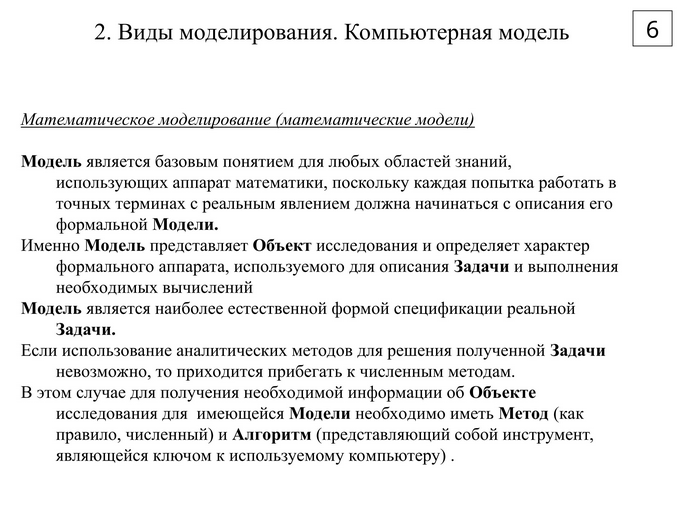

модель должна быть:
1. Достаточнро точной
2. Объём информации не должен превышать память
3. без выбросов по данным

ГОСТ Р 57412-2017

Верификация - процедура подтверждения работоспособности модели

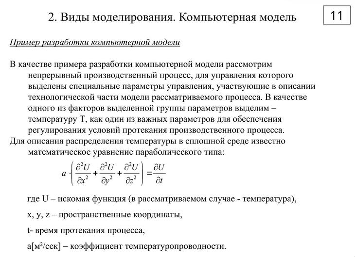

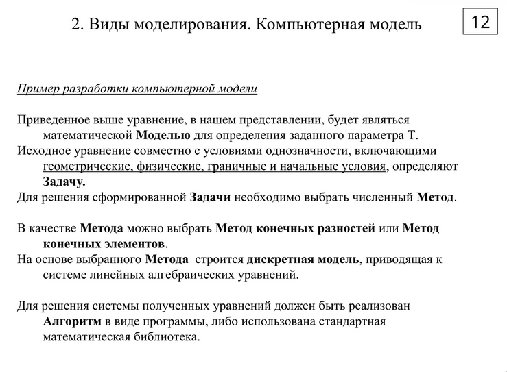

Система - сложный объект состоящий из взаимосвязных частей, которые связаны друг с другом

Структура - совокупность связей между элементами системы

Математические модели переводят цифровое сырьё в полезный цифровой продукт

CALS (Continuous Acquisition and Life cycle Support)

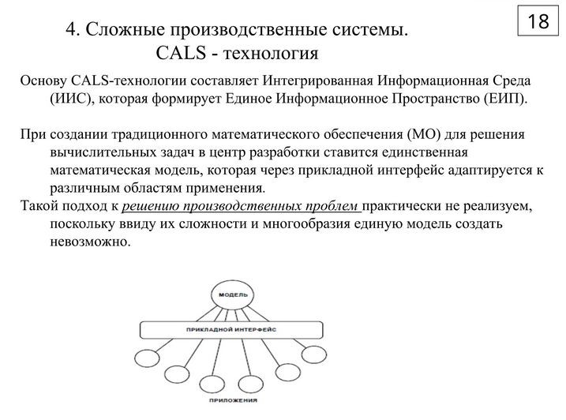

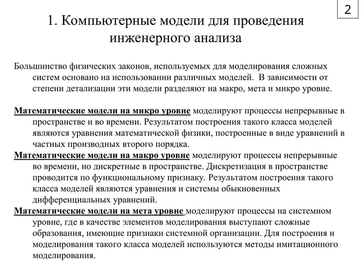

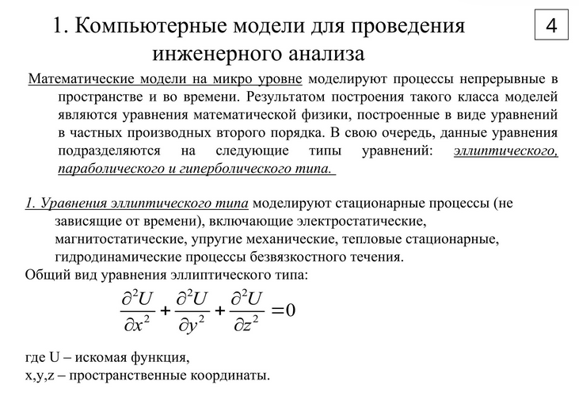

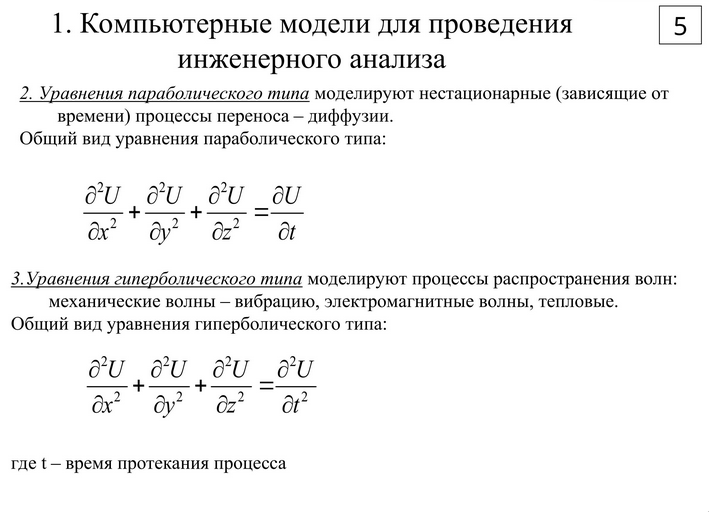

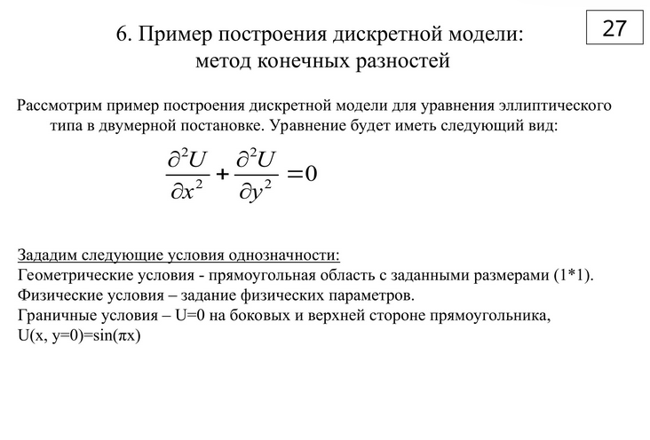

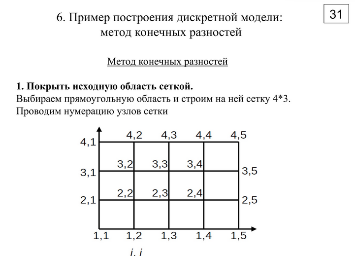

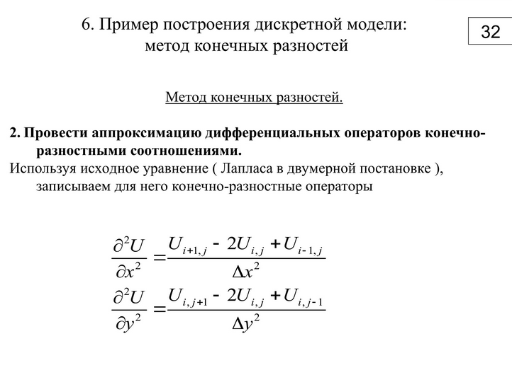

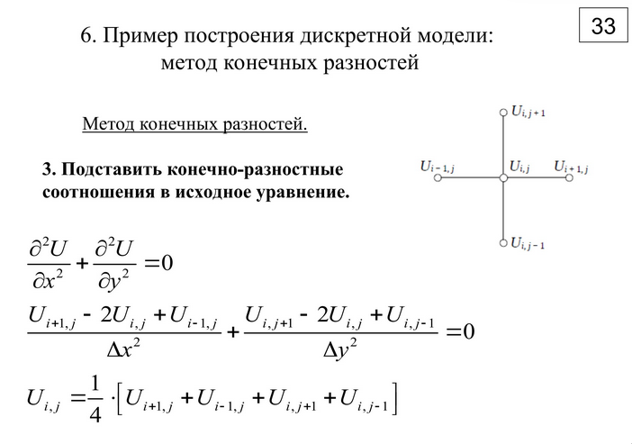

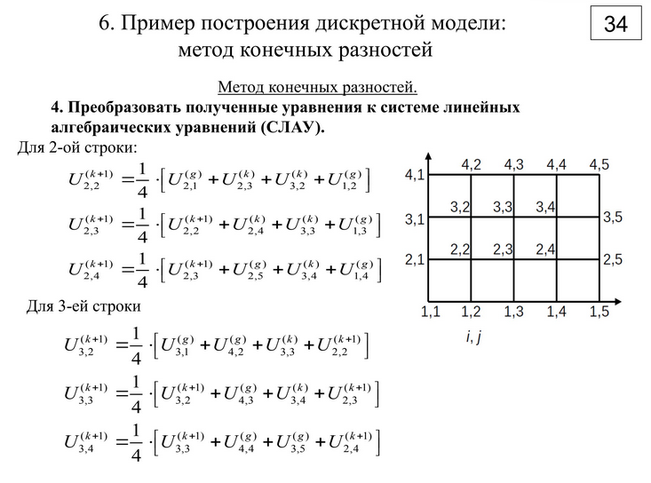

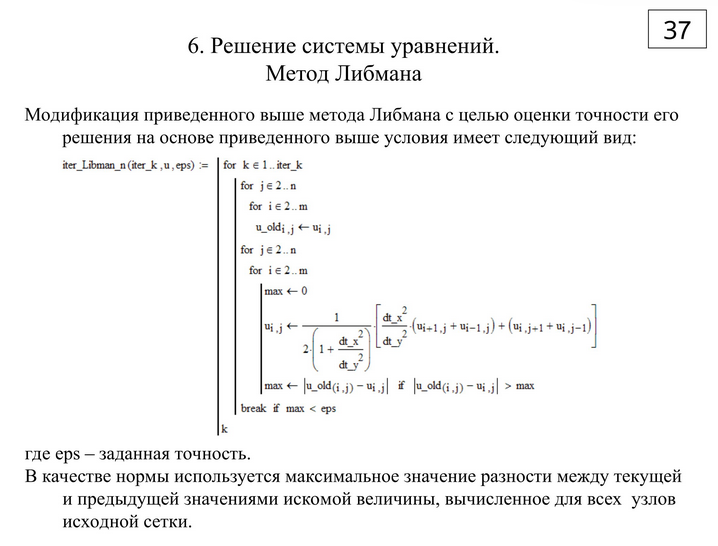

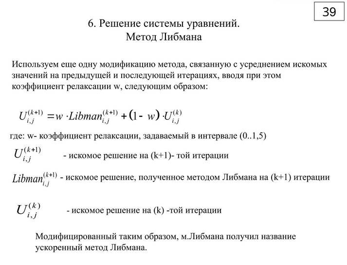

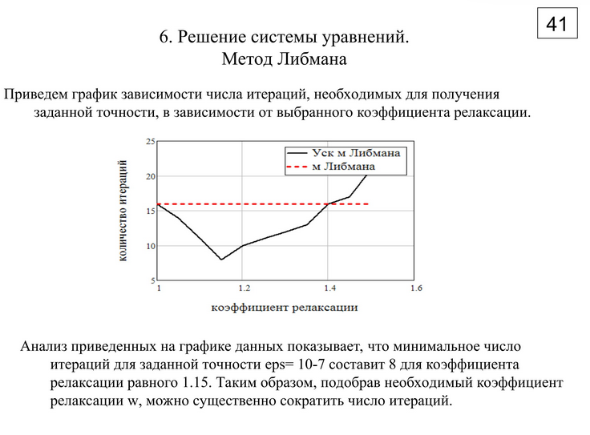

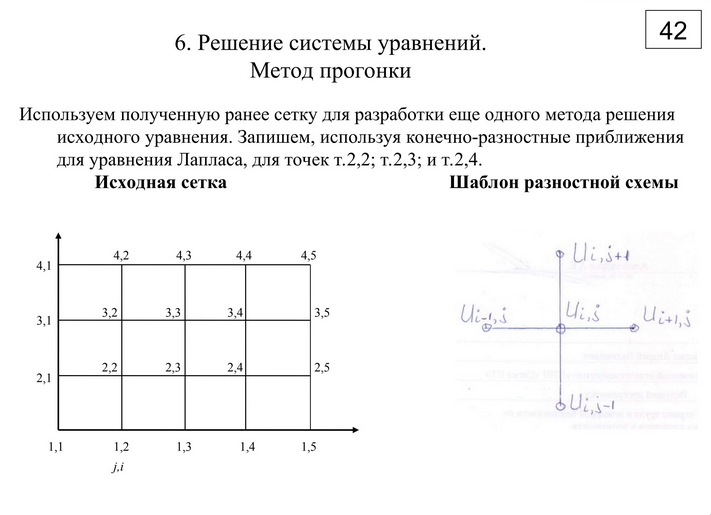
